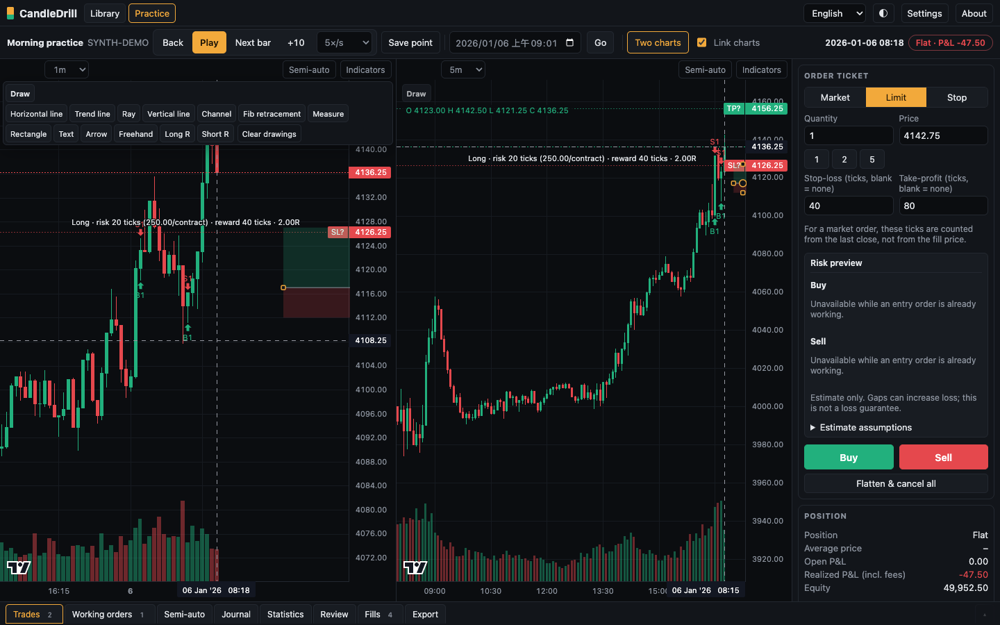
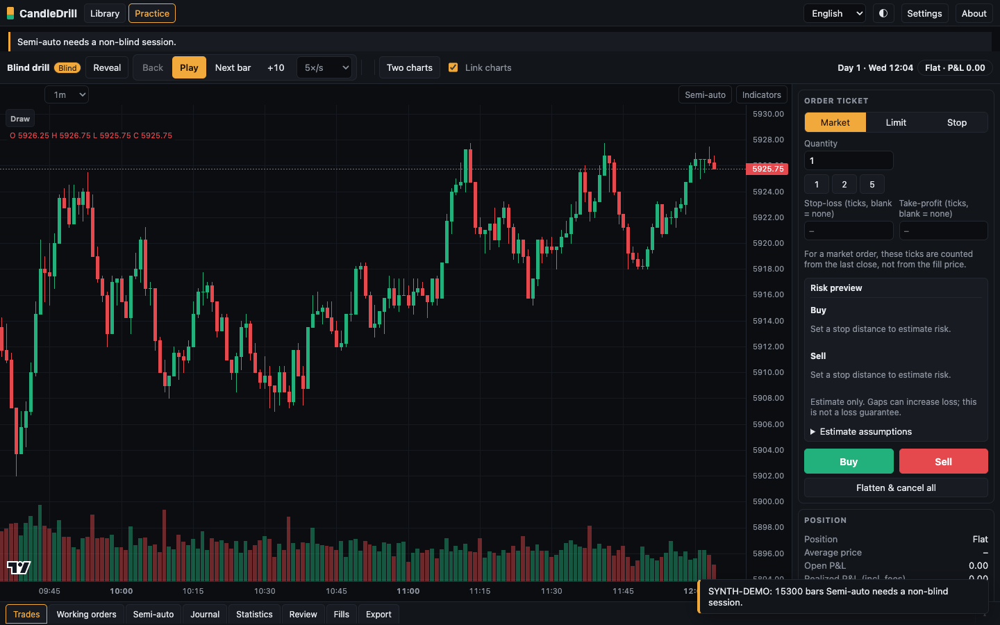
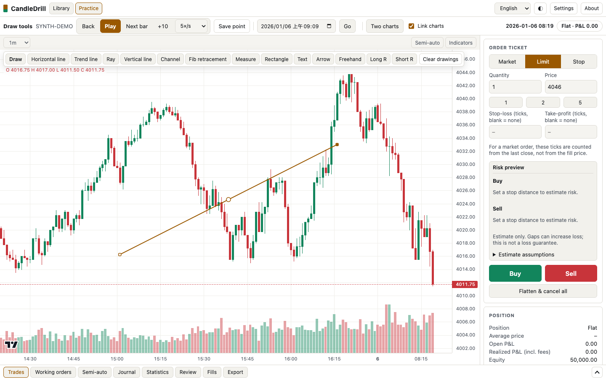
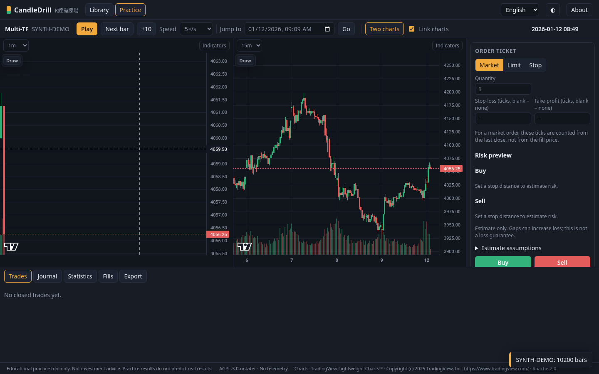
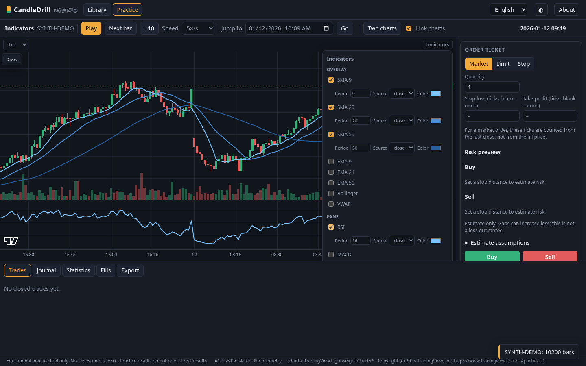

# CandleDrill

**CandleDrill** (Chinese: **K線操練場**) is a free, open-source tool for **candlestick replay practice** on your own computer.

Load bars → step through them without seeing the future → place simulated orders → review results.  
No account, no subscription, no telemetry. **Not investment advice.**

> **v0.3.0** · Local practice only. Report bugs in [Issues](https://github.com/Kinfxhk/candledrill/issues). [CHANGELOG](CHANGELOG.md)



<sub>Screenshot uses generated `SYNTH-` demo data, not real market prices.</sub>

繁體中文教學：[docs/guide.zh-Hant.md](docs/guide.zh-Hant.md)

## Install (about 5 minutes)

You need a desktop computer and [Node.js 22+](https://nodejs.org/) (LTS is fine).

```bash
git clone https://github.com/Kinfxhk/candledrill.git
cd candledrill
npm ci
npm start
```

Open <http://127.0.0.1:4870/> → **Generate demo data** → fill the session form → **Start practising**.

Data stays on your machine (`~/.candledrill/`). Prefer Docker? See [Quick extras](#quick-extras) below.

## Risk notice

CandleDrill is an **educational practice tool**. It is **not investment advice**,
it gives no trading signals, and **simulated or practice results do not predict
real trading results**. Trading futures, forex and other leveraged products can
lose more than your deposit. Bar-based simulation cannot know the true order of
prices inside a bar.

## Practice data

- **One-click demo:** **Generate demo data** creates synthetic bars (`SYNTH-…`). Same seed → same bars.
- **Longer Globex-like sample (synthetic only):**  
  [`Kinfxhk/candledrill-synth-samples`](https://github.com/Kinfxhk/candledrill-synth-samples)  
  Import `SYNTH-NQ-GLOBEX_1min.csv` as symbol **`PRACTICE-NQ-GLOBEX`**, tick size **`0.25`**, UTC offset **`-300`**.
- Or **Import CSV** of data you are entitled to use. CandleDrill ships **no real market data**.

## What you can do

### Blind practice

Hide the real symbol, shift dates and prices so you cannot recognise the chart. Reveal when finished.



<sub>**Blind practice** — random start, disguised symbol/dates/prices; Reveal restores the truth.</sub>

### Drawing tools

Floating **Draw** palette: horizontal / trend / rectangle, text, arrow, freehand, Long R / Short R. Click **Draw** again to collapse; Clear asks for confirmation.



<sub>**Drawing palette** — collapsible tools on the chart (not duplicated in the top bar).</sub>

### Two timeframes

Split view with linked crosshair and scroll. Change each pane’s timeframe (1m → daily).



<sub>**Multi-timeframe** — practise the same moment on two charts without look-ahead.</sub>

### Indicators

Searchable catalog: SMA / EMA (any periods), Bollinger, session VWAP, opening range (ORB), Donchian, RSI, MACD, ATR, Stochastic, ADX — computed only on bars already revealed. Settings stay in this browser (`candledrill.indicators.v2`).



<sub>**Indicators** — overlays and lower panes; settings stay on this computer only.</sub>

### Simulated macro

Stack bar-close conditions (ORB, moving average, RSI, and others), set a fixed stop and target, then **Backtest** or **Follow while playing**. Orders use the same fill model as the ticket. This is a local simulation: no broker, no live orders. The manual ticket stays on the right. Semi-auto is a four-step wizard on the bottom tab (the chart **Semi-auto** chip opens it). It needs a non-blind session. Details: [docs/MACRO.md](docs/MACRO.md).

### Orders & review

Market / limit / stop, brackets (SL/TP), risk preview, flatten. Trades, journal, statistics, CSV / HTML / session export. Optional practice rules (daily loss, trailing drawdown, profit target).

## Why CandleDrill

- **Free forever** — no paid tiers, ads, tracking, or accounts.
- **Local only** — server binds to `127.0.0.1`; one SQLite file you can back up.
- **Honest fills** — rules and limits are documented ([docs/FILL-MODEL.md](docs/FILL-MODEL.md)).
- **Desktop browsers** — not designed for a phone-sized window.
- Independent project; **not affiliated with** FX Replay, Forex Tester, TradeZella, TradingView, or any broker/exchange.

## Quick extras

<details>
<summary>Docker</summary>

```bash
docker compose up --build    # http://127.0.0.1:4870/
```

Publishes on the host’s **127.0.0.1 only**. Never expose CandleDrill to a network — it has no login.

</details>

<details>
<summary>CSV import tips</summary>

One row per bar: timestamp, open, high, low, close, optional volume. The import dialog guesses columns. Times without a zone use the UTC offset you choose. Only import data you are entitled to use.

</details>

<details>
<summary>Your data (backup / restore)</summary>

- Default DB: `~/.candledrill/candledrill.db` (Windows: `%USERPROFILE%\.candledrill\`).
- **Back up everything** / **Restore from backup** in the Library.
- Env: `CANDLEDRILL_PORT` (4870), `CANDLEDRILL_DATA_DIR`, `CANDLEDRILL_DB`. Host must stay `127.0.0.1`.

</details>

<details>
<summary>How fills work (short)</summary>

Orders fill only on bars revealed **after** placement. Market → next open ± slippage. Limit/stop gap through → fill at open (then slippage for stops). If one bar hits both SL and TP, **stop-loss first**. Full rules: [docs/FILL-MODEL.md](docs/FILL-MODEL.md).

</details>

<details>
<summary>Development</summary>

```bash
npm run check          # lint, tests, licence / no-market-data guards
npm run test:e2e       # Playwright smoke (needs Chromium once)
npm run screenshot     # regenerate docs/screenshot.png (server must be running)
node scripts/screenshot-gallery.mjs   # regenerate all README feature shots
```

Layout: `packages/core` (engine), `packages/server` (Fastify + SQLite), `packages/web` (UI).  
More: [docs/PERFORMANCE.md](docs/PERFORMANCE.md), [SECURITY.md](SECURITY.md), [CONTRIBUTING.md](CONTRIBUTING.md).

</details>

## 繁體中文簡介

**K線操練場**係免費、開源、喺自己電腦跑嘅 K 線回放練習工具：匯入數據 → 逐根前進（睇唔到未來）→ 模擬落單 → 檢討。唔使帳戶、唔追蹤。**介面供桌面瀏覽器使用**，唔保證手機闊度版面。

- **安裝：** Node.js 22+ → `npm ci && npm start` → 開 <http://127.0.0.1:4870/> → **Generate demo data**。
- **練習數據：** 內建 `SYNTH-` 示範；較長合成樣本見 [candledrill-synth-samples](https://github.com/Kinfxhk/candledrill-synth-samples)（匯入代號 `PRACTICE-NQ-GLOBEX`，tick `0.25`，utcOffset `-300`）。
- **完整教學：** [docs/guide.zh-Hant.md](docs/guide.zh-Hant.md)

**風險聲明：** 只作教育及練習用途，**並不構成任何投資建議**；**模擬或練習成績不能預示真實交易結果**。

## Licence

[GNU Affero General Public License v3.0 or later](LICENSE) (AGPL-3.0-or-later).  
Third-party notices: [THIRD_PARTY_NOTICES.md](THIRD_PARTY_NOTICES.md). Charts: [TradingView Lightweight Charts™](https://www.tradingview.com/lightweight-charts/) (Apache-2.0).

## Support

CandleDrill is free and will stay free. If it helps you: https://buymeacoffee.com/kinfxhk

如果這個工具對你有幫助，歡迎支持開發：https://buymeacoffee.com/kinfxhk
