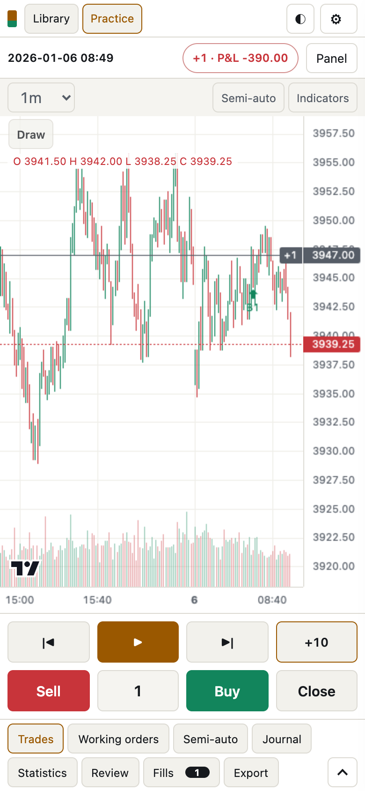
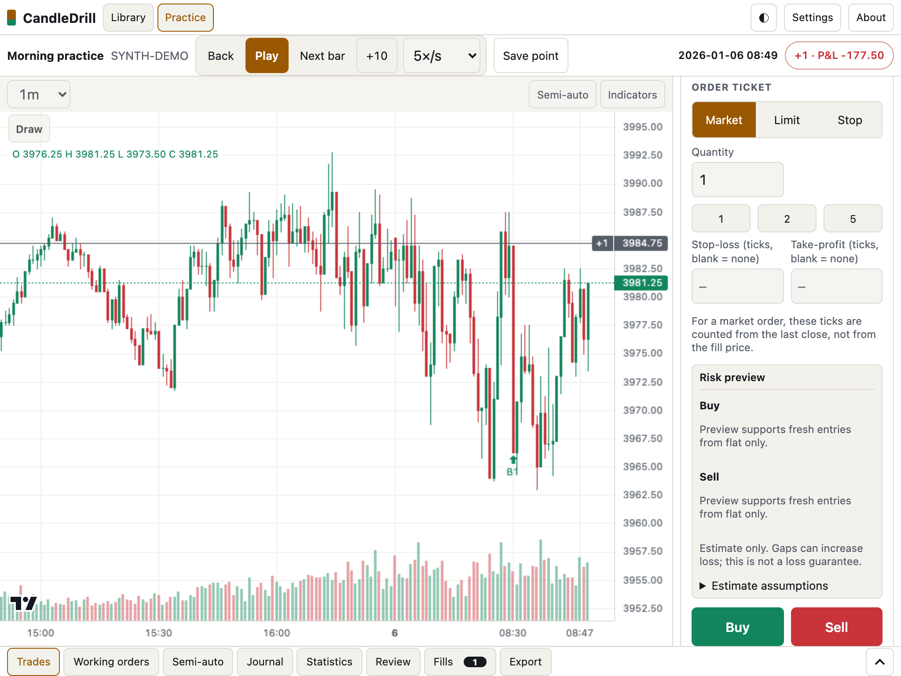
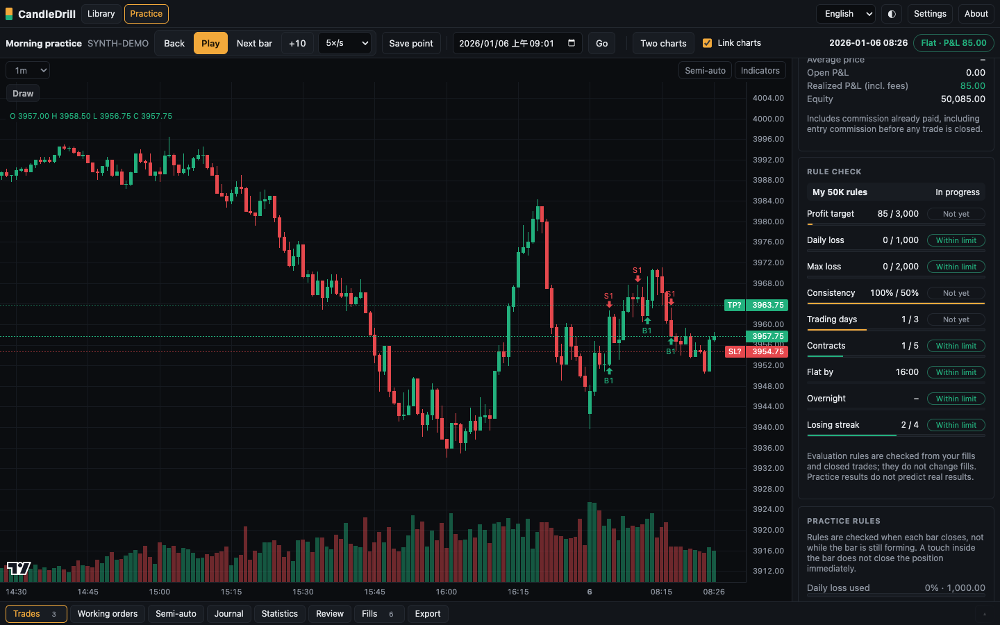
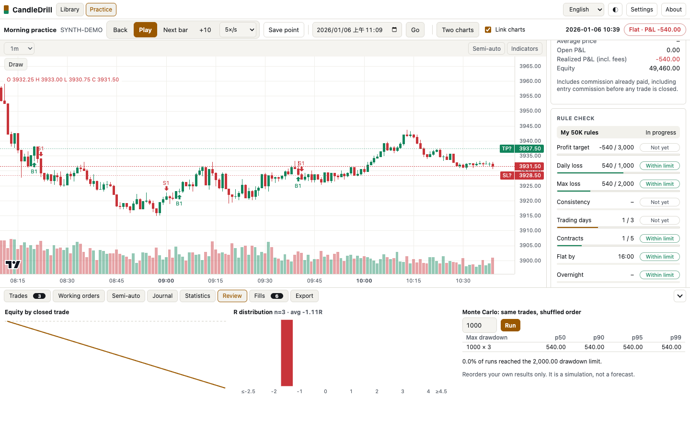
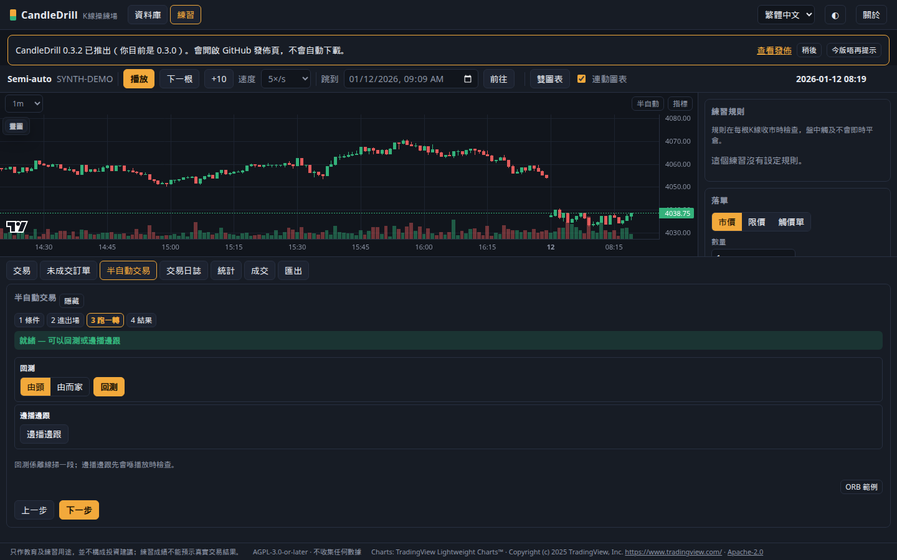
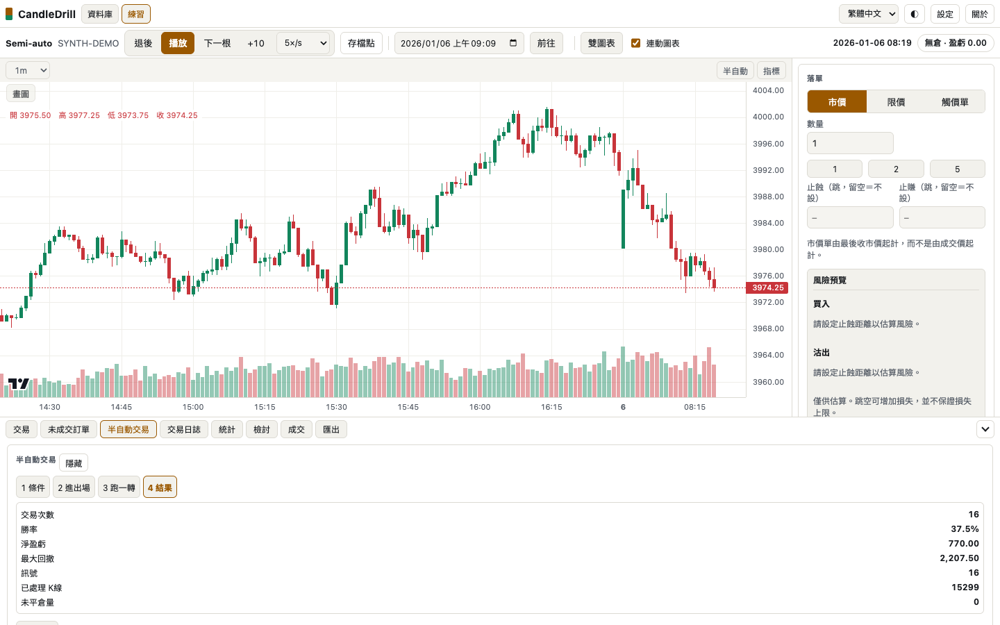

# CandleDrill（K線操練場）

**CandleDrill**（中文：**K線操練場**）是免費、開源的 **K 線回放練習工具**：匯入 K 線 → 逐根前進（看不到未來）→ 模擬下單 → 檢討結果。電腦、平板、手機都可以用。無需帳戶、無訂閱、無遙測。**不構成投資建議。**

> ### ▶ 線上版，開網址即玩：**<https://kinfxhk.github.io/candledrill/>**
>
> 手機、平板、電腦瀏覽器都可以用，不用安裝、不用登入。資料只存於你自己的瀏覽器，不會上傳。

> **v1.0.7** · 兩種用法：**瀏覽器版**（開網址即用，資料只存於你的瀏覽器）或**本機版**（自架，資料存於本機 SQLite）。問題請開 [Issues](https://github.com/Kinfxhk/candledrill/issues)。[CHANGELOG](CHANGELOG.md)


<sub>所有截圖使用產生的 `SYNTH-` 示範資料，並非真實市價。</sub>

完整教學（v0.2 實測稿）：[docs/guide.zh-Hant.md](docs/guide.zh-Hant.md)

## 風險聲明

CandleDrill 是**教育與練習工具**。**不構成投資建議**，不提供交易訊號，**模擬或練習成績不能預示真實交易結果**。期貨、外匯等槓桿商品可能損失超過本金。以 K 棒為單位的模擬，無法還原一根棒內真實的價格先後順序。若資料源是練習時框的三分之一（1 分鐘←20 秒、5 分鐘←100 秒、15 分鐘←300 秒），圖表會用它更新 forming K；**成交仍只在練習時框收棒時發生**（見 [docs/FILL-MODEL.md](docs/FILL-MODEL.md)）。只有已收市的練習時框、且那個間距本身不是 forming 來源時，不會在棒內編造路徑。

## 開始使用

### 瀏覽器版（手機、平板、電腦）

打開 **<https://kinfxhk.github.io/candledrill/>** → **產生示範數據** → 填寫練習表單 → **開始練習**。

- 不用安裝。所有運算在頁面內進行，資料存於**這個瀏覽器**（IndexedDB），不會上傳。
- 清除網站資料會一併刪除練習。請定期用 **全部備份**（一個 JSON 檔），換機時用 **從備份還原**。
- 盲練在瀏覽器版可保持練習公正，但資料在你的瀏覽器內，懂得用開發者工具仍可看到，**並非防偷看的鎖**。需要嚴格盲練請用本機版。

### 本機版（約 5 分鐘）

需要 [Node.js 22+](https://nodejs.org/)（LTS 即可）。

```bash
git clone https://github.com/Kinfxhk/candledrill.git
cd candledrill
npm ci
npm start
```

在本機開啟 <http://127.0.0.1:4870/>。資料存於 `~/.candledrill/`。服務**只聽** `127.0.0.1`，不會改聽區網位址；要在其他裝置連回本機版，請自行用 **Tailscale** 或 **SSH 本地埠轉發**。**請勿**把埠直接發佈到區網或公網（無登入機制），見 [SECURITY.md](SECURITY.md)。只想在手機或平板練習，用瀏覽器版即可。

## 三種版面

| 裝置                      | 版面                                                                                                                                                                                              |
| ------------------------- | ------------------------------------------------------------------------------------------------------------------------------------------------------------------------------------------------- |
| 桌面（≥ 1200px）          | 圖表佔大部分畫面；右欄由上至下：落單、持倉、規則檢查、練習規則、存檔點、繪圖物件；底部面板平時收成一條分頁列。                                                                                    |
| 平板橫放（900–1199px）    | 右欄收窄，仍與圖表並排。                                                                                                                                                                          |
| 平板直放、手機（< 900px） | 圖表優先；右欄變側邊抽屜（按「面板」）；底部固定交易列：退後／播放（播放中變暫停）／下一根／+10，沽出／數量／買入／平倉。任何面板（抽屜、交易分頁、指標、畫圖工具）撳外面即收起，畫面不用左右掃。 |



<sub>**手機（390×844）** — 合成 `SYNTH-` 示範資料。</sub>



<sub>**平板橫放（1024×768）** — 合成 `SYNTH-` 示範資料。</sub>

## 功能

### 回放手感

- **逐根前進**、+10、播放（0.5×–120×／秒），**退後**一步（左方向鍵）撤銷上一個動作，連同其成交。
- 「下一根」以練習時框計。來源是練習時框的三分之一時（1 分鐘 3 根 20 秒、5 分鐘 3 根 100 秒、15 分鐘 3 根 5 分鐘），按一下就走完一根練習 K，市價單在下一根練習 K 開市成交。畫面會先逐段畫出 forming，再收棒。
- **存檔點**：保存當下一刻，之後一鍵回到該處重練同一段。
- **跳到**指定時間（非盲練）。
- 圖表：滾輪／雙指縮放、拖曳平移、雙擊價格軸重設；左上角顯示開高低收。
- 退後與存檔點只能回到這個練習已發生過的狀態，伺服器（或瀏覽器版引擎）會按 K 線重新驗證，不能偽造成交；盲練揭曉前不能退後。

### 雙時框

分割畫面，十字線與捲動連動。各窗格可改時框（1 分 → 日線）。


<sub>**多時框** — 同一時刻在兩張圖練習，不偷看未來。合成 `SYNTH-` 示範資料。</sub>

### 下單

- 市價／限價／觸價單，括號單（止蝕／止賺以跳計），數量快捷，一鍵平倉。
- **落單前預覽**：圖上以虛線顯示按目前設定會落的止蝕與止賺（`SL?`／`TP?`）。
- 圖上拖曳價格手柄改單；風險預覽預設展開（止蝕損失、佔權益百分比、淨回報 R）。
- **止蝕管理**（設定內開啟）：浮盈達指定跳數後移至保本（可加跳數）、移動止蝕。每根 K 線收市後經正常「改單」移動止蝕單，只會收緊，不會放寬；成交規則不變。

### 繪圖工具

浮動 **畫圖** 工具列：水平線、趨勢線、**射線**、**垂直線**、**平行通道**、**斐波那契回調**、**量度**（價差、跳數、百分比、K 線數）、矩形、文字、箭頭、自由繪、好倉 R／淡倉 R。

- **磁吸**（設定內開啟）：點擊及拖曳時貼近該根 K 線的開／高／低／收。
- **繪圖物件**卡：逐個顯示／隱藏、鎖定／解鎖、刪除。


<sub>**繪圖工具列** — 合成 `SYNTH-` 示範資料。</sub>

### 自訂 Prop 規則檔

在資料庫頁 **規則檔** 卡建立你自己的規則。CandleDrill **不附任何公司的範本**，請以該公司現行官方文件核對。可匯出／匯入 JSON 分享。

| 規則                                   | 說明                                                 |
| -------------------------------------- | ---------------------------------------------------- |
| 帳戶金額、盈利目標                     | 填入練習表單的起始資金與目標                         |
| 每日虧損上限                           | 由成交引擎執行（觸發即平倉並停止落單）               |
| 最大虧損＋回撤計算方式                 | `eod`／`intraday`／`close`／`static`，由成交引擎執行 |
| 一致性                                 | 單日最高盈利不可超過總盈利的某個百分比               |
| 最少／最多交易日、盈利日數（每日至少） | 按成交與已平倉交易計算                               |
| 最多合約數、須於某時間前平倉、不可隔夜 | 按持倉期間計算，記錄違反時間                         |
| 每日最多交易、最多連續虧損             | 按已平倉交易計算                                     |

開新練習時選擇規則檔，表單會自動填入；練習時右欄 **規則檢查** 即時顯示每條規則「已達成／未觸及／未達成／已違反」及違反時間。評估規則只讀已揭示的成交與交易，**不改變成交**；獨立的 Python 驗證程式會重新計算每條規則。



<sub>**規則檢查** — 合成 `SYNTH-` 示範資料。</sub>

### 檢討

- 交易、成交、交易日誌（標籤與筆記）、統計、CSV／HTML／練習檔匯出。
- **檢討**分頁：按已平倉交易的權益曲線、R 分佈、**Monte Carlo**（同一批交易打亂次序，顯示最大回撤百分位及觸及回撤上限的比例；屬模擬，並非預測）。



<sub>**檢討** — 合成 `SYNTH-` 示範資料。</sub>

### 盲練

隱藏真實代號，並偏移日期與價格，避免一眼認出圖表。結束後再揭曉。


<sub>**盲練** — 隨機起點、偽裝代號／日期／價格。合成 `SYNTH-` 示範資料。</sub>

### 技術指標

可搜尋目錄：SMA／EMA（任意週期）、布林通道、盤中 VWAP、開盤區間（ORB）、唐奇安、RSI、MACD、ATR、隨機指標、ADX——只根據**已揭示**的 K 棒計算。設定留在本瀏覽器。


<sub>**指標** — 疊加線與下方視窗。合成 `SYNTH-` 示範資料。</sub>

### 半自動交易

從圖上的 **半自動**，或底部分頁 **半自動交易** 開啟；須為**非盲練**場次。四步：**條件 → 進出場 → 執行 → 結果**。

1. 選擇指標與反應，再按 **新增**。快速套用為選用。
2. 設定數量、方向、止蝕與目標。
3. 出現綠色就緒列後，可 **回測**（由開始｜由目前位置）或 **播放時跟隨**。按鈕呈灰色表示尚缺欄位。
4. 結果卡一律顯示：統計、0 筆成交及原因，或尚未執行。

只在本機模擬，不連接券商；右側手動下單票仍可使用。條件語法與 API 見 [docs/MACRO.md](docs/MACRO.md)。



<sub>**半自動 — 執行** — 合成 `SYNTH-` 資料。</sub>



<sub>**半自動 — 結果** — 合成 `SYNTH-` 資料。此例為 0 筆成交，卡片會說明原因。</sub>

### 設定

K 線顏色、格線、成交量、數量快捷、預設止蝕／止賺、「全部平倉」前確認、止蝕管理、落單前預覽、磁吸，以及**全部快捷鍵可自訂**（按該格再按新鍵；撞鍵會自動對調）。可匯出／匯入。

預設快捷鍵：`→` 下一根 · `Shift+→` +10 · `←` 退後 · `空白鍵` 播放／暫停 · `B` 買入 · `S` 沽出 · `F` 平倉 · `[` `]` 速度 · `P` 存檔點 · `Esc` 取消工具 · `Delete` 刪除選取繪圖。

#### 練習規則的兩個時鐘

- **開市錨點**（`anchorMinutes`）：開盤區間（ORB）、盤中 VWAP 與半自動 `orb_break` 所用的開市時鐘。選擇資料集時，會依第一根棒的交易所本地時間填入。
- **交易日開始**（`dayStartMinutes`）：每日虧損何時重置，亦是規則檔「交易日」的分界。

**回撤計算方式**（`trailingDrawdownMode`）預設為 `close`，只影響最大虧損規則；每日虧損仍以該棒收盤權益為準。

- `close` — 峰值隨每根棒收盤權益更新，棒內波動不計入。
- `eod` — 峰值僅在交易日界（日終）更新。
- `intraday` — 峰值採有利高低點；觸發則以不利高低點計，並於該價平倉。
- `static` — 底線固定為起始資金減去設定金額，不跟隨峰值。

舊練習檔仍可匯入：`anchorMinutes` 會複製自 `dayStartMinutes`，模式為 `close`。成交規則見 [docs/FILL-MODEL.md](docs/FILL-MODEL.md)。

## 練習資料

- **一鍵示範：** 先選練習時框（預設 1 分鐘），**產生示範數據** 會按該時框的三分之一產生合成 K（1 分鐘←20 秒、5 分鐘←100 秒、15 分鐘←5 分鐘；1 小時與日線同樣，`SYNTH-…`）。圖表選單不另開秒級時框。forming 隨來源更新，成交跟練習時框收棒。相同種子 → 相同 K 線。
- **較長的 Globex 風格樣本（僅合成）：** [`Kinfxhk/candledrill-synth-samples`](https://github.com/Kinfxhk/candledrill-synth-samples)，匯入 `SYNTH-NQ-GLOBEX_1min.csv`，代號 **`PRACTICE-NQ-GLOBEX`**，跳動 **`0.25`**，UTC 偏移 **`-300`**。
- 或 **匯入 CSV**：只匯入你有權使用的資料。CandleDrill **不附帶**真實市場資料。

## 為何選擇 CandleDrill

- **永久免費** — 無付費層級、無廣告、無追蹤、無需帳戶。
- **資料在你手上** — 瀏覽器版存於本機瀏覽器；本機版只綁定 `127.0.0.1`，一個 SQLite 檔可自行備份。
- **成交規則公開** — 規則與限制有文件說明（[docs/FILL-MODEL.md](docs/FILL-MODEL.md)），並由獨立的 Python 程式交叉驗證。
- 獨立專案；與 FX Replay、Forex Tester、TradeZella、TradingView 或任何券商／交易所／prop firm **沒有股權、代理或官方關係**。

## 補充說明

<details>
<summary>Docker（本機版）</summary>

```bash
docker compose up --build    # http://127.0.0.1:4870/
```

在主機上僅發佈 **127.0.0.1**。切勿將 CandleDrill 暴露到網路——沒有登入機制。

</details>

<details>
<summary>資料備份／還原</summary>

- 本機版資料庫：`~/.candledrill/candledrill.db`（Windows：`%USERPROFILE%\.candledrill\`），備份是 SQLite 檔。
- 瀏覽器版：備份是一個 JSON 檔，包含數據集、K 線與練習。兩種備份格式不能互換。
- 規則檔、設定、存檔點存於瀏覽器 localStorage；規則檔與設定可各自匯出。
- 環境變數（本機版）：`CANDLEDRILL_PORT`（4870）、`CANDLEDRILL_DATA_DIR`、`CANDLEDRILL_DB`。主機位址必須維持 `127.0.0.1`。

</details>

<details>
<summary>CSV 匯入提示</summary>

每列一根棒：時間戳、開、高、低、收，可選成交量。匯入對話框會嘗試猜測欄位。無時區的時間會套用你選擇的 UTC 偏移。可匯入練習時框的三分之一（或更細且能整除該時框）的 K，forming 會更新，成交仍跟練習時框收棒。5 分鐘 K 是 15 分鐘的 forming 來源（三根真實 5 分鐘 K）。若檔案的間距已是練習時框、且不是 forming 來源（例如只有 15 分鐘 K），不會在棒內 forming。時框選單仍從練習時框起，不另開 20／100 秒選項。

</details>

<details>
<summary>成交方式（簡述）</summary>

訂單只會在下單**之後**揭示的 K 棒上成交。市價 → 下一根開盤 ± 滑價。限價／停損若跳空穿過 → 以開盤成交（停損再加滑價）。同一根棒同時觸及 SL 與 TP 時，**先停損**。完整規則：[docs/FILL-MODEL.md](docs/FILL-MODEL.md)。

</details>

<details>
<summary>開發</summary>

```bash
npm run check          # lint、格式、型別、測試、授權／無市價資料／密鑰檢查
npm run oracle         # 獨立 Python 驗證（1,000 個隨機練習、盲練、備份、規則檔）
npm run test:e2e       # Playwright（需先裝一次 Chromium）
sh scripts/build-pages.sh dist-pages   # 建置瀏覽器版
node scripts/screenshot-gallery.mjs    # 重新產生 README 截圖（本機版須在執行）
```

結構：`packages/core`（純引擎，無 I/O）、`packages/server`（Fastify + SQLite）、`packages/web`（介面；`local-backend.ts` 是瀏覽器版的引擎＋IndexedDB，與伺服器的 API 相同，並有 parity 測試）。  
更多：[docs/PERFORMANCE.md](docs/PERFORMANCE.md)、[SECURITY.md](SECURITY.md)、[CONTRIBUTING.md](CONTRIBUTING.md)。

</details>

## 推薦連結與披露

作者的推薦連結頁：<https://linktr.ee/kinfx>（在 App 的「關於」內亦有，預設收起）。

**推薦連結（含聯盟佣金）：** 我可能因你註冊而獲得佣金。評估帳戶多為模擬，練習成績不代表真實交易結果。非香港證監會持牌人，非投資建議。期貨及槓桿產品可引致重大虧損。完整披露見 App「關於 → 推薦連結（含聯盟佣金）」及 [NOTICE](NOTICE)。此商業關係不影響程式碼、示範數據及規則判定。

## 授權

[GNU Affero General Public License v3.0 or later](LICENSE)（AGPL-3.0-or-later）。  
第三方聲明：[THIRD_PARTY_NOTICES.md](THIRD_PARTY_NOTICES.md)。圖表：[TradingView Lightweight Charts™](https://www.tradingview.com/lightweight-charts/)（Apache-2.0）。

## 支持開發

CandleDrill 免費，也會持續免費。若這個工具對你有幫助：https://buymeacoffee.com/kinfxhk

---

# CandleDrill (English)

**CandleDrill** (Chinese: **K線操練場**) is a free, open-source **candlestick replay practice** tool: load bars → step without seeing the future → place simulated orders → review. Works on desktop, tablet and phone. No account, no subscription, no telemetry. **Not investment advice.**

> ### ▶ Try it online: **<https://kinfxhk.github.io/candledrill/>**
>
> Works in any phone, tablet or desktop browser. No install, no sign-in. Your data stays in your own browser.

> **v1.0.7** · Two ways to run it: the **browser version** (open a URL; data stays in your browser) or the **local version** (self-hosted; data in a local SQLite file). Bugs: [Issues](https://github.com/Kinfxhk/candledrill/issues). [CHANGELOG](CHANGELOG.md)


<sub>All screenshots use generated `SYNTH-` demo data, not real market prices.</sub>

Traditional Chinese guide (v0.2 field notes): [docs/guide.zh-Hant.md](docs/guide.zh-Hant.md)

## Risk notice

CandleDrill is an **educational practice tool**. It is **not investment advice**,
it gives no trading signals, and **simulated or practice results do not predict
real trading results**. Trading futures, forex and other leveraged products can
lose more than your deposit. Bar-based simulation cannot know the true order of
prices inside a bar. If the data source is one third of the practice timeframe (1m←20s, 5m←100s, 15m←300s), the chart uses those bars to update a forming candle; **fills still occur only on practice-timeframe closes** (see [docs/FILL-MODEL.md](docs/FILL-MODEL.md)). A file whose spacing is already a practice timeframe and not a forming source does not grow a made-up path inside the bar.

## Getting started

### Browser version (phone, tablet, desktop)

Open **<https://kinfxhk.github.io/candledrill/>** → **Generate demo data** → fill the session form → **Start practising**.

- Nothing to install. Everything runs in the page; data is stored in **this browser** (IndexedDB) and never uploaded.
- Clearing site data deletes it. Use **Back up everything** (one JSON file) and **Restore from backup** to move devices.
- Blind mode here keeps practice honest, but the data is in your browser, so devtools can reveal it: **it is not a lock against looking**. Use the local version for strict blind practice.

### Local version (about 5 minutes)

You need [Node.js 22+](https://nodejs.org/) (LTS is fine).

```bash
git clone https://github.com/Kinfxhk/candledrill.git
cd candledrill
npm ci
npm start
```

Open <http://127.0.0.1:4870/> on this machine. Data stays in `~/.candledrill/`. The server listens on **`127.0.0.1` only** and will not bind to your LAN; to reach the local version from another device, use your own **Tailscale** or **SSH local port forward**. **Do not** publish the port to your LAN or the public internet (no login) — see [SECURITY.md](SECURITY.md). To practise on a phone or tablet, the browser version is simpler.

## Three layouts

| Device                           | Layout                                                                                                                                                                                                                                                                         |
| -------------------------------- | ------------------------------------------------------------------------------------------------------------------------------------------------------------------------------------------------------------------------------------------------------------------------------ |
| Desktop (≥ 1200px)               | Chart takes most of the screen; the rail holds, top to bottom: order ticket, position, rule check, practice rules, save points, drawings; the bottom panel folds to a tab strip.                                                                                               |
| Tablet landscape (900–1199px)    | Narrower rail, still beside the chart.                                                                                                                                                                                                                                         |
| Tablet portrait, phone (< 900px) | Chart first; the rail is a drawer (**Panel**); a sticky trade bar: back / play (shows pause while playing) / next / +10, sell / qty / buy / close. Any panel (drawer, bottom tabs, indicators, draw tools) closes when you tap outside it, and nothing needs a sideways swipe. |

## What you can do

### Replay feel

- **Step**, +10, play (0.5–120 bars/s), and **Back** (Left arrow) undoes the last action, fills included.
- **Next bar** counts practice bars. With a source of practice/3 (three 20s bars in a 1m bar, three 100s bars in a 5m bar, three 5m bars in a 15m bar), one press completes a whole practice bar, so a market order fills at the next practice open. The candle paints each source bar before that close.
- **Save points** keep a moment so you can return and drill the same stretch again.
- **Jump to** a time (non-blind); **two charts** with linked crosshair and scroll, each with its own timeframe (1m → daily).
- Chart: wheel / pinch zoom, drag to pan, double-click the price scale to reset; OHLC legend top-left.
- Back and save points only restore states this session has already been in. The server (or the browser engine) re-validates them against the bars, so fills cannot be invented; Back is off in a blind session until you reveal.

### Orders

- Market / limit / stop, brackets (SL / TP in ticks), quantity presets, flatten.
- **Bracket preview**: dashed `SL?` / `TP?` lines show where the ticket's stop and target would go before you order.
- Drag order handles on the chart to modify; risk preview open by default (stop loss, share of equity, net reward in R).
- **Stop management** (Settings): break-even after N ticks in profit (optional offset) and a trailing stop. After each bar close the stop-loss order is moved through the normal modify path; it only ever tightens and the fill model is unchanged.

### Drawing tools

Floating **Draw** palette: horizontal, trend, **ray**, **vertical line**, **parallel channel**, **Fibonacci retracement**, **measure** (price, ticks, %, bars), rectangle, text, arrow, freehand, Long R / Short R.

- **Magnet** (Settings): clicks and drags snap to the bar's open / high / low / close.
- **Drawings** card: show / hide, lock / unlock and delete each drawing.

### Your own prop rule profiles

Create rules on the Library's **Rule profiles** card. CandleDrill **ships no firm presets**; check your rules against the firm's current official documents. Export / import as JSON.

| Rule                                                    | Notes                                                                |
| ------------------------------------------------------- | -------------------------------------------------------------------- |
| Account size, profit target                             | Fill the session's starting balance and target                       |
| Daily loss limit                                        | Enforced by the fill engine (flatten and stop trading on breach)     |
| Max loss + drawdown mode                                | `eod` / `intraday` / `close` / `static`, enforced by the fill engine |
| Consistency                                             | Best day may not exceed a share of total profit                      |
| Min / max trading days, profitable days (each at least) | From fills and closed trades                                         |
| Max contracts, flat by a time, no overnight             | From the open position over time, with the time of a break           |
| Max trades per day, max losing streak                   | From closed trades                                                   |

Pick a profile when you start a session and the form fills in; the **Rule check** on the rail shows each rule as met / within limit / not yet / broken, with when. Evaluation rules read revealed fills and trades only and **never change fills**; an independent Python oracle recomputes every rule.

### Review

- Trades, fills, journal (tags and notes), statistics, CSV / HTML / session-file export.
- **Review** tab: equity by closed trade, R distribution, and a **Monte Carlo** that reorders the same trades (max-drawdown percentiles and the share of runs that hit the drawdown limit; a simulation, not a forecast).

### Blind practice

Hide the real symbol, shift dates and prices so you cannot recognise the chart. Reveal when finished.

### Indicators

Searchable catalog: SMA / EMA (any periods), Bollinger, session VWAP, opening range (ORB), Donchian, RSI, MACD, ATR, Stochastic, ADX — computed only on bars already revealed. Settings stay in this browser.

### Semi-auto

Open the chart chip **Semi-auto**, or the bottom tab. Needs a **non-blind** session. Four steps: **Conditions → Entry & exit → Run → Result**.

1. Pick an indicator, pick a reaction, then **Add**. Quick-apply chips are optional.
2. Set quantity, side, stop, and target.
3. A green ready line, then **Backtest** (**From start** | **From here**) or **Follow while playing**. Grey means a field is still missing.
4. The result card is always there: stats, 0 trades and a reason, or not run yet.

Simulated only — no broker. The manual ticket stays on the right. DSL and API: [docs/MACRO.md](docs/MACRO.md).

### Settings

Candle colours, grid, volume, quantity presets, default SL / TP, confirm before Flatten all, stop management, bracket preview, magnet, and **every hotkey can be rebound** (click the cell, press a key; a clash swaps). Export / import.

Default keys: `→` next bar · `Shift+→` +10 · `←` back · `Space` play / pause · `B` buy · `S` sell · `F` flatten · `[` `]` speed · `P` save point · `Esc` cancel tool · `Delete` delete selected drawing.

#### The two practice clocks

- **Market open anchor** (`anchorMinutes`) is the market-open clock for the opening range (ORB), session VWAP, and the semi-auto `orb_break` window. Picking a dataset fills it from the first bar's exchange-local time.
- **Trading day start** (`dayStartMinutes`) is when the daily loss limit resets; it is also the day boundary for rule profiles.

**Drawdown mode** (`trailingDrawdownMode`) defaults to `close`. It only changes the max-loss rule. Daily loss still uses equity at the bar close.

- `close` — the peak follows equity at each bar close. A move inside the bar does not count.
- `eod` — the peak updates only at the trading-day boundary (end of day).
- `intraday` — the peak uses the favourable high or low. A breach uses the adverse high or low, and the position closes at that price.
- `static` — the floor stays at starting balance minus the amount. It does not follow a peak.

Older session files still import: `anchorMinutes` copies `dayStartMinutes`, and the mode is `close`. Order fills: [docs/FILL-MODEL.md](docs/FILL-MODEL.md).

## Practice data

- **One-click demo:** Pick a practice timeframe (default 1 minute), then **Generate demo data** builds synthetic bars at one third of that timeframe (1m←20s, 5m←100s, 15m←5m, 1h←20m, 1D←8h, `SYNTH-…`). 1m–1h use the 08:00–16:30 session. 1D uses a full day so the three 8h bars can form the daily candle. The chart menu does not add a seconds timeframe. Forming updates from the source; fills still follow practice-timeframe closes. Same seed → same bars.
- **Longer Globex-like sample (synthetic only):** [`Kinfxhk/candledrill-synth-samples`](https://github.com/Kinfxhk/candledrill-synth-samples) — import `SYNTH-NQ-GLOBEX_1min.csv` as symbol **`PRACTICE-NQ-GLOBEX`**, tick size **`0.25`**, UTC offset **`-300`**.
- Or **Import CSV** of data you are entitled to use. CandleDrill ships **no real market data**.

## Why CandleDrill

- **Free forever** — no paid tiers, ads, tracking, or accounts.
- **Your data stays with you** — browser version in your browser; local version binds to `127.0.0.1` with one SQLite file you can back up.
- **Honest fills** — rules and limits are documented ([docs/FILL-MODEL.md](docs/FILL-MODEL.md)) and cross-checked by an independent Python oracle.
- Independent project; **no equity, agency or official relationship** with FX Replay, Forex Tester, TradeZella, TradingView, or any broker / exchange / prop firm.

## Quick extras

<details>
<summary>Docker (local version)</summary>

```bash
docker compose up --build    # http://127.0.0.1:4870/
```

Publishes on the host’s **127.0.0.1 only**. Never expose CandleDrill to a network — it has no login.

</details>

<details>
<summary>CSV import tips</summary>

One row per bar: timestamp, open, high, low, close, optional volume. The import dialog guesses columns. Times without a zone use the UTC offset you choose. You may import bars at practice/3 (or a finer spacing that divides the practice timeframe); the candle forms from those bars and fills still follow practice-timeframe closes. A 5-minute file is the forming source of 15m (three real 5m bars). A file whose spacing is already the practice timeframe and not a forming source (15m candles alone, for example) does not form inside the bar. The pane menu still starts at the practice timeframe and does not offer 20s or 100s. Only import data you are entitled to use.

</details>

<details>
<summary>Your data (backup / restore)</summary>

- Local version DB: `~/.candledrill/candledrill.db` (Windows: `%USERPROFILE%\.candledrill\`); backups are SQLite files.
- Browser version: the backup is one JSON file with datasets, bars and sessions. The two backup formats are not interchangeable.
- Rule profiles, settings and save points live in browser localStorage; profiles and settings can be exported.
- Env (local version): `CANDLEDRILL_PORT` (4870), `CANDLEDRILL_DATA_DIR`, `CANDLEDRILL_DB`. Host must stay `127.0.0.1`.

</details>

<details>
<summary>How fills work (short)</summary>

Orders fill only on bars revealed **after** placement. Market → next open ± slippage. Limit/stop gap through → fill at open (then slippage for stops). If one bar hits both SL and TP, **stop-loss first**. Full rules: [docs/FILL-MODEL.md](docs/FILL-MODEL.md).

</details>

<details>
<summary>Development</summary>

```bash
npm run check          # lint, format, types, tests, licence / no-market-data / secret guards
npm run oracle         # independent Python oracle (1,000 random sessions, blind, backup, profiles)
npm run test:e2e       # Playwright (needs Chromium once)
sh scripts/build-pages.sh dist-pages   # build the browser version
node scripts/screenshot-gallery.mjs    # regenerate README shots (local version running)
```

Layout: `packages/core` (pure engine, no I/O), `packages/server` (Fastify + SQLite), `packages/web` (UI; `local-backend.ts` is the browser version's engine + IndexedDB, same API as the server, covered by a parity test).  
More: [docs/PERFORMANCE.md](docs/PERFORMANCE.md), [SECURITY.md](SECURITY.md), [CONTRIBUTING.md](CONTRIBUTING.md).

</details>

## Recommendations and disclosure

The author's link page: <https://linktr.ee/kinfx> (also in the app under About, folded by default).

**Affiliate links:** I may earn a commission if you sign up. Evaluations are mostly simulated; practice results do not reflect live trading. Not licensed by the Hong Kong SFC; not investment advice. Futures and leveraged products can cause substantial losses. Full disclosure: in the app under **About → Recommendations (affiliate links)** and in [NOTICE](NOTICE). That relationship does not affect the code, demo data or rule evaluation.

## Licence

[GNU Affero General Public License v3.0 or later](LICENSE) (AGPL-3.0-or-later).  
Third-party notices: [THIRD_PARTY_NOTICES.md](THIRD_PARTY_NOTICES.md). Charts: [TradingView Lightweight Charts™](https://www.tradingview.com/lightweight-charts/) (Apache-2.0).

## Support

CandleDrill is free and will stay free. If it helps you: https://buymeacoffee.com/kinfxhk
